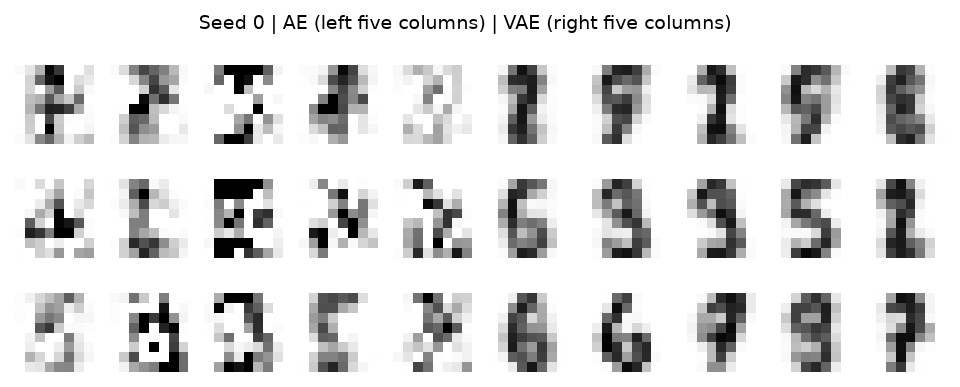
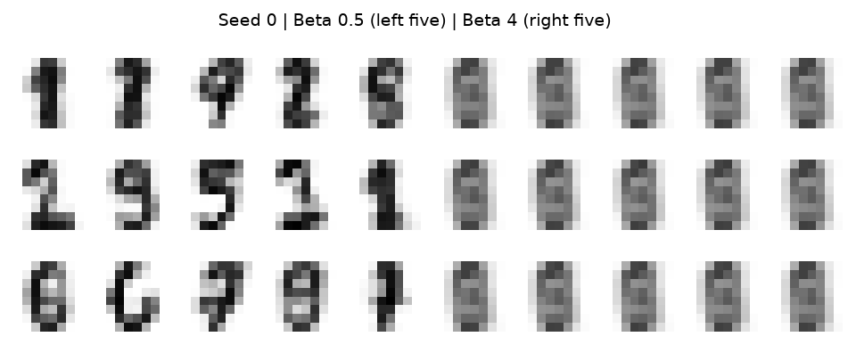
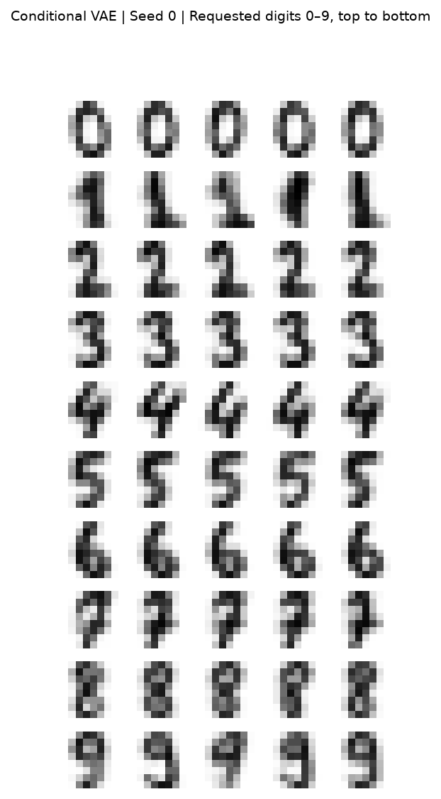

# AIGC-5500 Lab 7 - Latent Spaces

**Student:** Daniel Alejandro Castillo Martin  
**Student ID:** N10019284  
**Course:** Advanced Deep Learning (AIGC-5500-0NA)  
**Professor:** Hossein Pourmodheji

---

Lab 07 submission for **Advanced Deep Learning (AIGC-5500)** in the Artificial Intelligence with Machine Learning postgraduate program at Humber Polytechnic.

This project implements and verifies a variational autoencoder (VAE) in PyTorch using 8 × 8 digit images. It compares a plain autoencoder (AE) and a VAE on reconstruction and prior sampling, evaluates how the KL weight affects latent activity, and examines interpolation, class conditioning, and generative metrics.

## 1. Setup

**Requirements:** Python 3.14.6, PyTorch, NumPy, SciPy, scikit-learn, Matplotlib, pandas, and IPython with a Jupyter-compatible notebook environment. The pinned package versions are in `requirements.txt`.

Clone the repository:

```powershell
git clone https://github.com/dancmartin11/aigc-5500-lab-07-latent-spaces.git
cd aigc-5500-lab-07-latent-spaces
```

Create and activate a virtual environment in Windows PowerShell:

```powershell
python -m venv .venv
.\.venv\Scripts\Activate.ps1
python -m pip install -r requirements.txt
```

On Linux or macOS:

```bash
python3 -m venv .venv
source .venv/bin/activate
python -m pip install -r requirements.txt
```

## 2. Project Structure

```text
aigc-5500-lab-07-latent-spaces/
├── scripts/
│   └── lab07_starter.py
├── src/
│   ├── __init__.py
│   ├── vae.py
│   ├── experiments.py
│   ├── evaluation.py
│   ├── kl_sweep.py
│   ├── interpolation.py
│   ├── conditional_vae.py
│   └── metric_study.py
├── output/
│   └── figures/
│       ├── ae_vs_vae_prior_samples.png
│       ├── posterior_collapse.png
│       └── conditional_prior_samples.png
├── daniel_alejandro_castillo_martin_LAB7.ipynb
├── .gitignore
├── README.md
└── requirements.txt
```

The `scripts/` directory contains the instructor-provided starter. The `src/` package contains the VAE implementations, objectives, and experiment helpers. The notebook runs the checks and experiments and presents the tables and figures.

## 3. Run

From the repository root, run the starter check:

```powershell
python scripts/lab07_starter.py
```

The starter prints the train and test shapes, reports baseline results, and writes `starter_check.png`.

Open `daniel_alejandro_castillo_martin_LAB7.ipynb` in VS Code or Jupyter, select the `.venv` kernel, and run all cells in order. The notebook trains the models, produces the tables, and writes the figures to `output/figures/`.

## 4. Hardware and Reproducibility

| Component | Configuration |
|---|---|
| Operating system | Windows |
| Python | 3.14.6 |
| Training device | CPU |
| CPU model | Intel Core Ultra 7 155U |
| Full notebook runtime | 5 min 32 sec |

| Experimental setting | Value |
|---|---|
| Dataset | scikit-learn Digits |
| Image size | 8 × 8 pixels, flattened to 64 values and scaled to [0, 1] |
| Training / test images | 1,438 / 359 |
| Data split seed | 0 |
| Training seeds | 0, 1, 2 |
| Hidden width | 64 |
| Latent dimensions | 8 |
| Epochs per model | 200 |
| Batch size | 64 |
| Learning rate | 2e-3 |
| Optimizer | Adam |
| KL weights | 0.1, 0.5, 1, 2, 4 |
| Prior samples per generative metric comparison | 359 |

The lab specifies the learning rate and training budget. The matched AE and VAE runs use the same data split, hidden width, latent size, and training settings. The KL sweep reuses the three `beta = 1` models from that comparison.

The VAE reconstruction term sums binary cross-entropy over pixels, and the KL term sums divergence over latent dimensions. The objective averages reconstruction plus weighted KL over the batch. Test reconstruction MSE in the AE and VAE comparison averages squared error over both images and pixels. The VAE uses the posterior mean for that comparison.

Generative comparisons use the same feature network trained on the training split and the same held-out test features. The sample-size experiment varies only the number of training images in the comparison subset.

## 5. Prediction (Written Before the KL-Weight Sweep)

### Hypothesis 1 — Reconstruction and Posterior Collapse

I expect the KL divergence to decrease and reconstruction to worsen as the KL weight increases. At `beta = 4`, I expect the KL divergence to approach zero and few or no latent dimensions to remain active. Together, these findings would indicate posterior collapse because the encoder would produce distributions close to the prior across inputs.

### Hypothesis 2 — Quality of Prior Samples

I expect `beta = 0.5` to give the lowest mean Fréchet distance across the three seeds. At `beta = 0.1`, the weak KL penalty may allow the encoder to use regions that are rarely sampled from the prior. I expect `beta = 0.5` to improve alignment with the prior while retaining enough information to reconstruct the digits.

## 6. Results

### 6.1 VAE Implementation and Verification

| Verification | Result |
|---|---|
| Closed-form KL vs. Monte Carlo | All five estimates were within four Monte Carlo standard errors. The largest absolute difference was 0.0247. |
| Reconstruction gradient at the encoder mean head | The gradient norm was 0.689904 with reparameterization and 0.000000 after detaching the latent sample. |
| VAE loss vs. negative ELBO at `beta = 1` | The absolute difference was 3.81 × 10⁻⁶ using the same latent draws. |

### 6.2 Autoencoder vs. VAE

| Seed | Model | Test MSE | Fréchet | Precision | Recall | Nearest train |
|---:|---|---:|---:|---:|---:|---:|
| 0 | AE | 0.01524 | 72.256 | 0.384 | 0.875 | 2.0550 |
| 0 | VAE | 0.02592 | 14.331 | 0.922 | 0.448 | 1.1408 |
| 1 | AE | 0.01508 | 88.199 | 0.382 | 0.772 | 2.1491 |
| 1 | VAE | 0.02653 | 12.685 | 0.897 | 0.412 | 1.1230 |
| 2 | AE | 0.01491 | 100.596 | 0.462 | 0.749 | 2.3329 |
| 2 | VAE | 0.02626 | 15.171 | 0.908 | 0.432 | 1.1249 |

The AE reconstructed test images more accurately in every seed, averaging 0.01508 MSE compared with 0.02624 for the VAE. On prior samples, the VAE had lower mean Fréchet distance (14.06 vs. 87.02) and higher mean precision (0.909 vs. 0.409). Its mean recall was lower (0.431 vs. 0.799).

The table below reports the standard deviation of each AE code or VAE posterior mean across training images.

| Seed | Model | Latent dimensions 1–8 |
|---:|---|---|
| 0 | AE | 0.684, 0.867, 0.565, 0.629, 0.689, 0.807, 0.531, 0.669 |
| 0 | VAE | 0.944, 0.959, 0.936, 0.481, 0.022, 0.824, 0.020, 0.034 |
| 1 | AE | 0.630, 0.573, 0.754, 0.645, 1.086, 0.659, 0.744, 0.647 |
| 1 | VAE | 0.904, 0.445, 0.812, 0.912, 0.894, 0.021, 0.025, 0.038 |
| 2 | AE | 0.719, 0.763, 0.753, 0.706, 0.610, 0.707, 0.767, 0.730 |
| 2 | VAE | 0.892, 0.919, 0.906, 0.026, 0.536, 0.820, 0.032, 0.021 |

Three VAE posterior-mean dimensions had standard deviations below 0.04 in each seed. All eight AE code dimensions varied across training images, but the AE reconstruction objective imposed no constraint on how those codes aligned with the standard normal prior. The VAE's KL term encouraged alignment with the prior, consistent with the lower Fréchet distance and higher precision of its prior samples.



### 6.3 KL-Weight Sweep

The reconstruction column reports summed binary cross-entropy averaged over the test images, with one latent draw per image. The KL column reports mean test KL per image. A latent unit is active when its posterior mean has a variance above 0.01 across training images.

| Beta | Seed | Reconstruction | KL | Active units | Fréchet | Precision | Recall |
|---:|---:|---:|---:|---:|---:|---:|---:|
| 0.1 | 0 | 17.2655 | 14.2050 | 8 | 9.748 | 0.733 | 0.866 |
| 0.1 | 1 | 17.1090 | 14.2085 | 8 | 10.728 | 0.680 | 0.889 |
| 0.1 | 2 | 17.1023 | 14.2729 | 8 | 11.812 | 0.713 | 0.869 |
| 0.5 | 0 | 19.3256 | 5.8331 | 7 | 8.864 | 0.889 | 0.749 |
| 0.5 | 1 | 19.3121 | 5.9524 | 7 | 8.653 | 0.830 | 0.643 |
| 0.5 | 2 | 19.0256 | 6.1410 | 7 | 9.894 | 0.805 | 0.788 |
| 1 | 0 | 21.0200 | 3.4785 | 5 | 14.331 | 0.922 | 0.448 |
| 1 | 1 | 21.3753 | 3.2206 | 5 | 12.685 | 0.897 | 0.412 |
| 1 | 2 | 20.9902 | 3.3034 | 5 | 15.171 | 0.908 | 0.432 |
| 2 | 0 | 24.2804 | 1.2615 | 3 | 45.004 | 0.911 | 0.156 |
| 2 | 1 | 24.5625 | 1.1579 | 3 | 42.374 | 0.939 | 0.086 |
| 2 | 2 | 24.3269 | 1.2493 | 4 | 41.822 | 0.911 | 0.067 |
| 4 | 0 | 27.2462 | 0.0012 | 0 | 219.270 | 1.000 | 0.000 |
| 4 | 1 | 27.2555 | 0.0011 | 0 | 218.830 | 1.000 | 0.000 |
| 4 | 2 | 27.2422 | 0.0005 | 0 | 223.802 | 1.000 | 0.000 |

Increasing beta raised reconstruction loss and reduced KL divergence in every seed. Beta 0.5 had the lowest Fréchet distance in all three seeds, supporting the pre-sweep prediction. At beta 4, near-zero KL, zero active units, and nearly identical decoded samples indicated posterior collapse.



### 6.4 Latent Interpolation and Conditional Generation

Interpolation used the same 40 test-image pairs with different digit labels and 10 frames per path. Each entry reports mean classifier confidence / mean predicted class changes per path.

| Method | Seed 0 | Seed 1 | Seed 2 |
|---|---:|---:|---:|
| AE latent | 0.921 / 1.67 | 0.938 / 1.62 | 0.934 / 1.70 |
| VAE latent | 0.912 / 1.60 | 0.919 / 1.73 | 0.914 / 1.77 |
| Pixel cross-fade | 0.938 / 1.25 | 0.938 / 1.25 | 0.938 / 1.25 |

Pixel cross-fade had the fewest predicted class changes in every seed and matched or exceeded latent interpolation confidence at the reported precision. The latent paths showed no improvement over this baseline under the two measured criteria.

The feature network matched all 200 conditional samples per requested digit in each seed, for 6,000 of 6,000 matches. The table reports predicted digit counts for 1,000 unconditional prior draws per seed.

| Seed | 0 | 1 | 2 | 3 | 4 | 5 | 6 | 7 | 8 | 9 |
|---:|---:|---:|---:|---:|---:|---:|---:|---:|---:|---:|
| 0 | 98 | 85 | 88 | 124 | 112 | 89 | 113 | 92 | 126 | 73 |
| 1 | 89 | 64 | 95 | 121 | 102 | 93 | 119 | 101 | 120 | 96 |
| 2 | 110 | 97 | 78 | 136 | 98 | 79 | 110 | 83 | 118 | 91 |



### 6.5 Generative Metrics

Each entry reports Fréchet distance / precision / recall / mean nearest-training distance for 359 images.

| Sample set | Seed 0 | Seed 1 | Seed 2 |
|---|---|---|---|
| Real training images | 2.833 / 0.900 / 0.911 / 0.0000 | 2.929 / 0.936 / 0.925 / 0.0000 | 2.620 / 0.930 / 0.919 / 0.0000 |
| Noisy training copies | 3.090 / 0.911 / 0.916 / 0.1340 | 3.015 / 0.944 / 0.925 / 0.1338 | 2.972 / 0.933 / 0.925 / 0.1330 |
| Noisy mean image | 140.675 / 0.933 / 0.000 / 1.6210 | 136.992 / 0.967 / 0.000 / 1.6216 | 137.276 / 0.969 / 0.000 / 1.6192 |
| Collapsed VAE (beta 4) | 219.270 / 1.000 / 0.000 / 1.5097 | 218.830 / 1.000 / 0.000 / 1.5053 | 223.802 / 1.000 / 0.000 / 1.5149 |
| VAE (beta 1) | 14.331 / 0.922 / 0.448 / 1.1408 | 12.685 / 0.897 / 0.412 / 1.1230 | 15.171 / 0.908 / 0.432 / 1.1249 |
| Plain AE | 72.256 / 0.384 / 0.875 / 2.0550 | 88.199 / 0.382 / 0.772 / 2.1491 | 100.596 / 0.462 / 0.749 / 2.3329 |

Fréchet distance separated the collapsed VAE and noisy mean image from real images, but the noisy training copies scored close to real images. Their small nearest-training distances exposed the copying. Precision remained high for the noisy mean image and reached 1.000 for the collapsed VAE, while recall was zero for both. In the other direction, the AE's high recall coexisted with low precision. Nearest-training distance measures pixel-space similarity and cannot establish sample quality by itself. Classification accuracy requires target labels, which unconditional draws lack. Conditional match rate measures adherence to the requested label and leaves within-class diversity unevaluated.

### 6.6 Fréchet Distance vs. Sample Size

Each training subset was compared with the same 359 held-out images using ten draws per size. Sampling was without replacement within each draw.

| Training subset size | Draws | Mean Fréchet | Standard deviation |
|---:|---:|---:|---:|
| 30 | 10 | 25.788 | 9.964 |
| 60 | 10 | 9.661 | 2.459 |
| 120 | 10 | 5.977 | 1.854 |
| 359 | 10 | 2.886 | 0.495 |
| 1,000 | 10 | 1.838 | 0.247 |

Mean Fréchet distance and its variability decreased as the training subsets grew, even though all subsets contained real images and the test reference stayed fixed. The 359-image row provides a size-matched reference for the generator comparisons.

## 7. Conclusion

The plain autoencoder reconstructed test images more accurately, while the VAE at beta 1 produced prior samples with lower Fréchet distance and higher precision. Within the sweep, beta 0.5 gave the lowest Fréchet distance in every seed, and beta 4 led to posterior collapse. The conditional VAE reliably followed the requested digit according to the feature network. Pixel cross-fade remained the strongest interpolation baseline under the measured criteria.

## 8. Known Limitations

The experiments use 8 × 8 digit images, one small architecture family, one feature network trained on the digit training split, a fixed training budget, and three training seeds. Fréchet distance depends on the learned features and the number of samples. Precision and recall depend on the feature neighborhoods. The conditional match rate does not quantify within-class diversity, and nearest-training distance is sensitive to pixel-level changes.

## 9. Repository

[Lab 07 on GitHub](https://github.com/dancmartin11/aigc-5500-lab-07-latent-spaces)